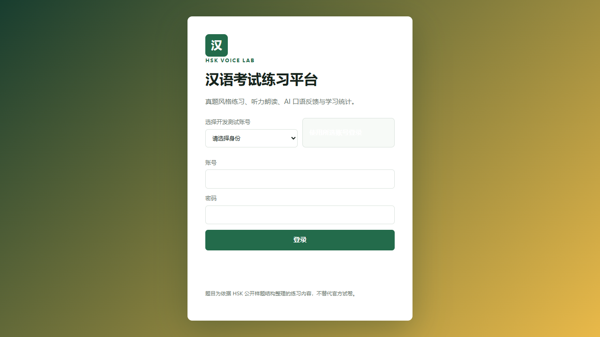
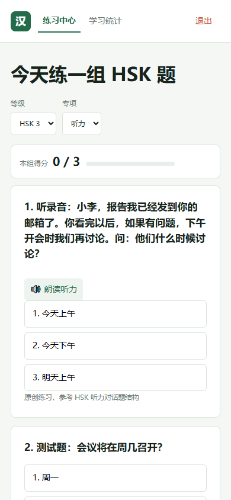
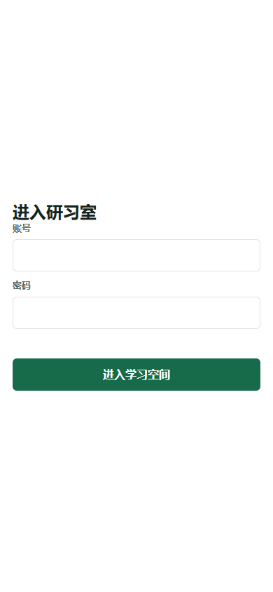
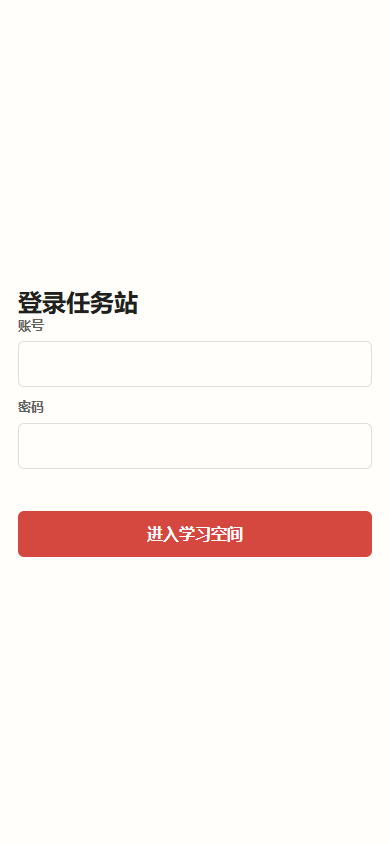
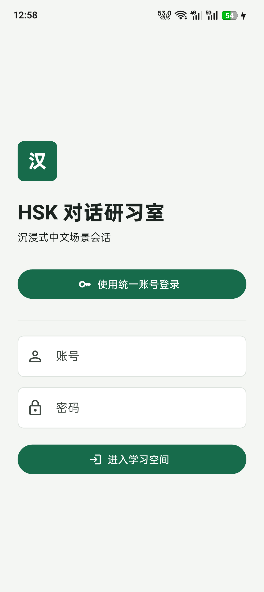
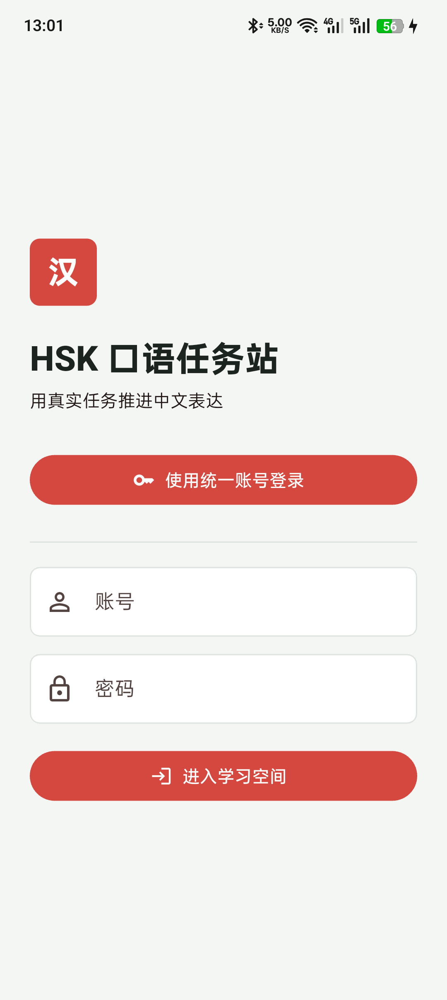
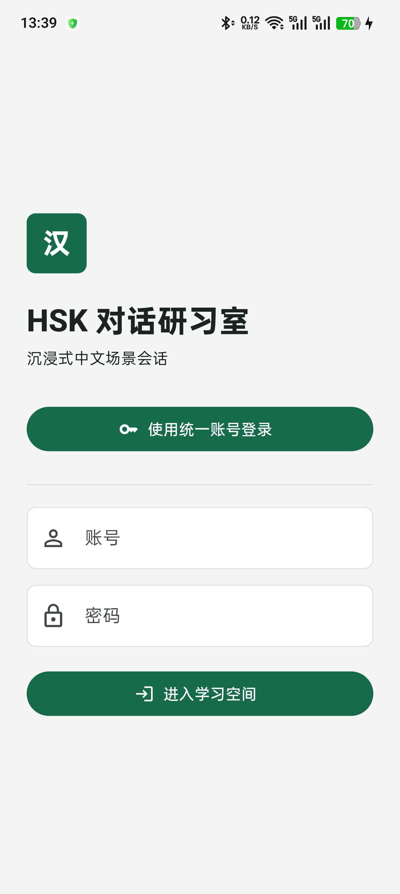
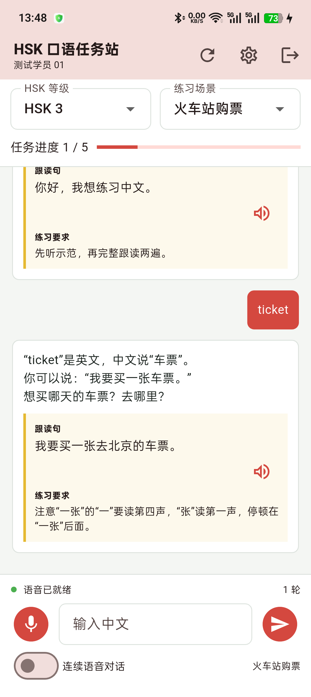

# HSK 语音学习系统 用户操作手册

版本号：V1.0

> 状态：草稿/需人工确认。截图来自本轮运行记录；正式提交前仍需补齐正式账号、版本和完整真机验收记录。

## 目录

1. 运行环境与入口
2. Web 综合练习平台（学生、教师）
3. Web 对话研习室与口语任务站（学生、教师）
4. Android 移动端（学生、教师）
5. 语音操作与异常处理
6. 测试证据与限制

---

## 1. 运行环境与入口

适用角色：学生、教师。

Windows 浏览器入口为 `/platform/`、`/studio/` 和 `/mission/`；Android 设备安装对应 APK 后进入登录页。服务不可用时页面会显示登录或请求错误，需联系系统管理员确认 API 和数据库状态。

## 2. Web 综合练习平台（学生、教师）

适用角色：学生可以选等级、专项、作答、查看解析和统计；教师可以在题库管理页发布题目。

### 2.1 登录与进入练习

1. 打开 `/platform/`。
2. 在账号和密码输入框填写已分配账号。桌面端测试人员可以使用测试账号选择入口，手机端不显示该入口。
3. 点击“登录”。登录成功后进入“练习中心”。

图 2-1（a）平台桌面登录页；入口：`/platform/`。

### 2.2 选择专项和提交答案

1. 在“等级”选择 HSK 1 至 HSK 4。
2. 在“专项”选择听力、阅读或口语。
3. 阅读题目或点击“朗读听力”，选择答案。
4. 页面立即显示正确性和解析，并更新本组得分。

图 2-2（a）移动端练习页；入口：`/platform/`，接口：`GET /api/practice/questions`、`POST /api/practice/attempts`。

### 2.3 学习统计和题库管理

学生点击“学习统计”查看累计作答、正确率和专项趋势。教师登录后出现“题库管理”，填写等级、专项、题目、选项和答案，点击“发布题目”；非 teacher 角色调用接口会返回 403。

## 3. Web 对话研习室与口语任务站（学生、教师）

适用角色：学生进行会话或任务练习；教师账号可用于权限边界验证，但当前页面不提供独立的教师管理台。

### 3.1 进入会话

打开 `/studio/` 或 `/mission/`，填写账号密码后点击“进入学习空间”。登录后在桌面端可选择 HSK 等级和场景；移动端直接保留标题、当前场景、消息区和输入区。

图 3-1（a）研习室移动登录页；入口：`/studio/`。

图 3-2（a）任务站移动登录页；入口：`/mission/`。

### 3.2 文字对话

在输入框输入中文，点击“发送”或按 Enter。服务端会将当前 HSK 等级、场景和最近 24 条消息发送给模型，返回正文、跟读句和练习要求。消息失败时保留错误提示，用户可以重新发送。

### 3.3 开始语音和回放

点击“说”开始录音，再次点击停止；识别文本进入消息区后提交 AI。语音完成后，用户消息下方出现录音播放器，可暂停、拖动或重新播放。开启连续语音模式后，AI 朗读结束会自动进入下一轮监听。

## 4. Android 移动端（学生、教师）

适用角色：学生、教师。两个 APK 使用独立 `client_app` 保存最近会话。

### 4.1 登录

启动 APK 后，登录页只展示产品标题、统一账号登录、账号、密码和进入学习空间。测试账号下拉与服务地址长文本不显示，以保证首屏聚焦。

图 4-1（a）对话研习室 Android 登录页；应用包 `com.hskvoice.hsk_dialogue_studio`。

图 4-2（a）口语任务站 Android 登录页；应用包 `com.hskvoice.hsk_mission_lab`。

### 4.2 文字、语音和历史

登录后可以选择等级和场景、输入文字、点击麦克风录音、等待转写和 AI 回答。应用恢复最近一次文本会话；点击“开始新会话”清理当前会话链路。录音存放在应用私有目录，数据库只存转写文本和音频字节数。

图 4-3（a）对话研习室 Android 登录后会话、文字回复和录音状态。

图 4-4（a）口语任务站 Android 登录后任务进度和文字回复。

## 5. 语音操作与异常处理

浏览器不支持 SpeechRecognition 时，语音状态提示用户使用最新版 Edge 或 Chrome，文字输入仍可用。Android 拒绝麦克风权限时，录音按钮会失败并显示错误；网络中断时 API 返回错误，恢复网络后可重新提交。模型超时、空回答和无效 WAV 均由服务端返回可读错误。

## 6. 测试证据与限制

本轮 Node 单测 37 项、两个 Flutter 测试套件和 analyze 均通过；两个 APK 已编译、安装并启动。截图来自本轮 Windows 浏览器和 Android 真机。真人长语音、相机、图片识别、知识库和完整四角色链路未完成，不能依据本手册宣称这些能力已交付。
