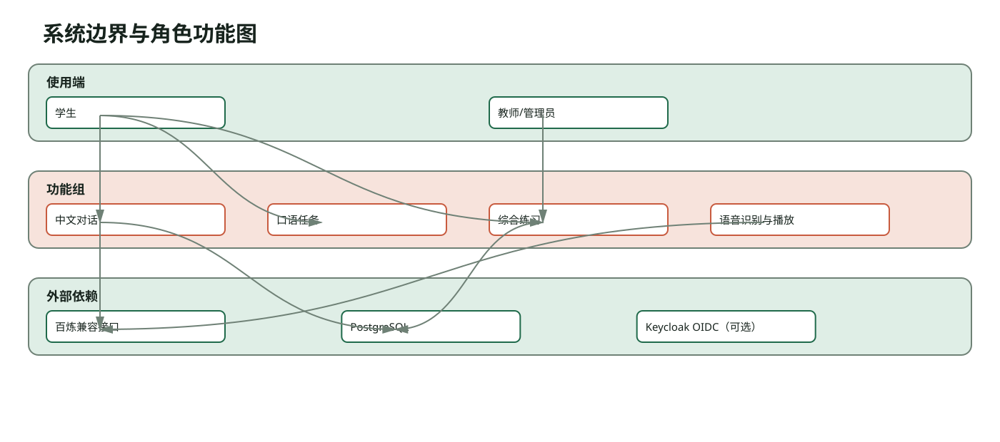
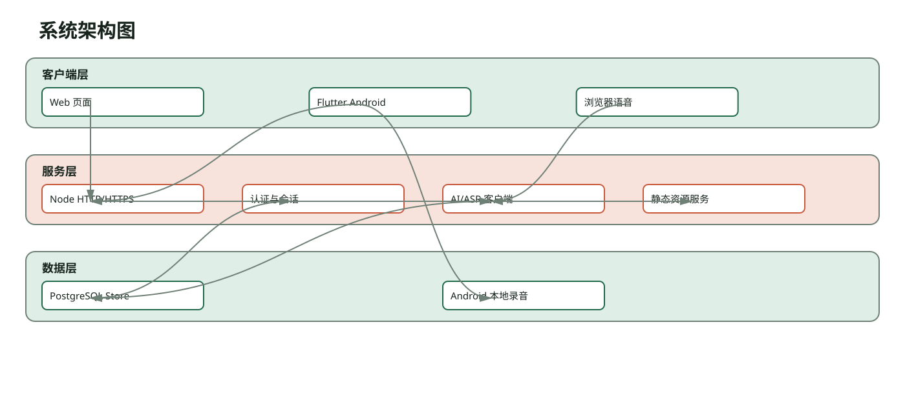
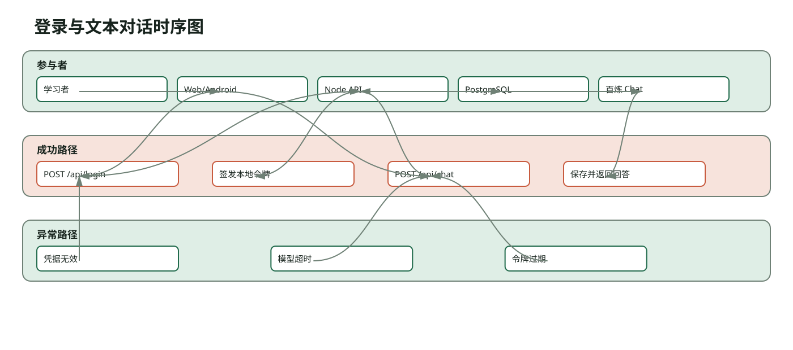
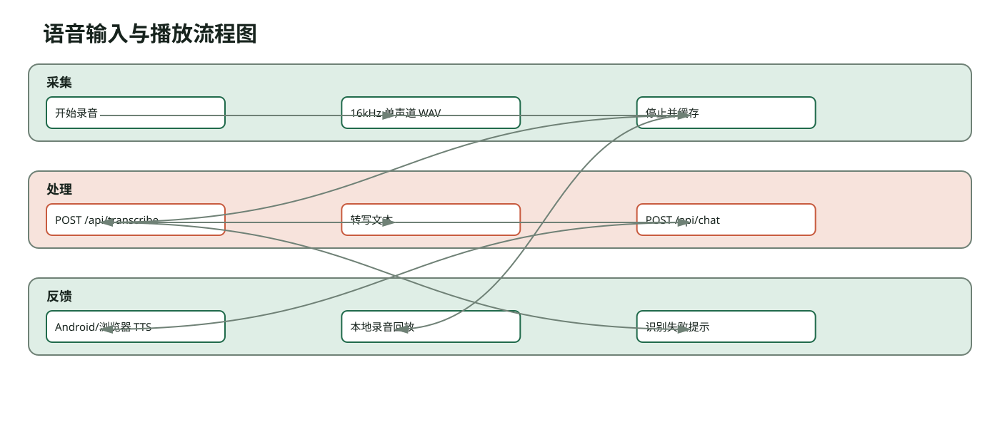
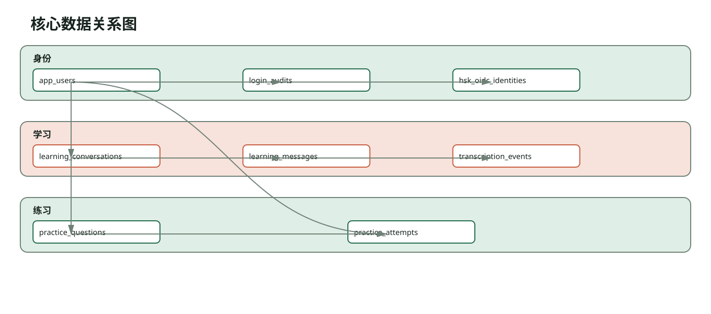
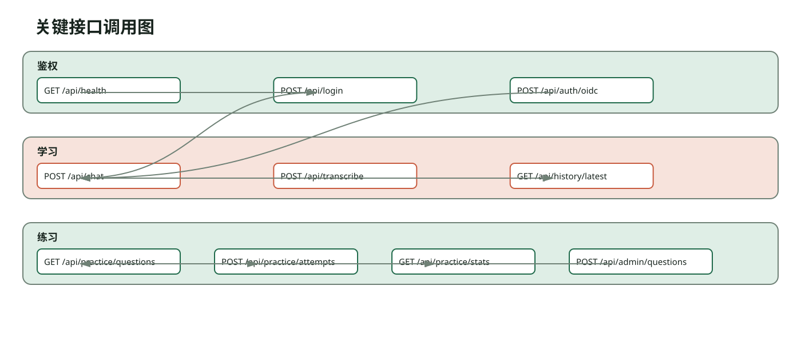
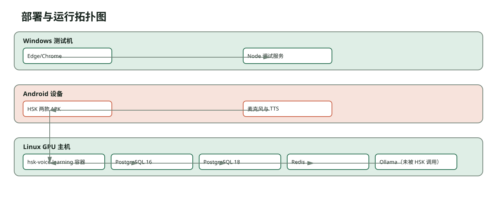

# HSK 语音学习系统 软件设计说明书

版本号：V1.0

> 状态：草稿/需人工确认。当前正文少于软著交付所需的 40 页，且仍有真实 Android AI 链路、正式登记信息待补充；本稿用于记录已核验事实，不作为最终提交稿。

> 本稿依据当前提交、运行页面和本轮测试证据编写；申请主体及部分历史开发信息待申请人确认。

## 目录

1. [需求背景](#需求背景)
2. [系统范围](#系统范围)
3. [角色与权限](#角色与权限)
4. [Web 端布局](#Web 端布局)
5. [Android 端布局](#Android 端布局)
6. [认证与会话](#认证与会话)
7. [文本对话](#文本对话)
8. [语音链路](#语音链路)
9. [综合练习](#综合练习)
10. [数据设计](#数据设计)
11. [接口设计](#接口设计)
12. [部署与运行](#部署与运行)
13. [安全与隐私](#安全与隐私)
14. [测试与证据](#测试与证据)
15. [缺口与边界](#缺口与边界)

---

## 需求背景

系统面向需要持续练习中文口语的学习者。代码中将学习场景、HSK 等级、文字消息、转写事件和 AI 回答作为独立对象，目标是让一次练习从输入、处理到反馈保持连续。

当前实现不包含图片采集、图片识别和知识库检索接口，因此这些能力不写入已实现功能。普通用户角色也未在当前角色声明中出现；服务端实际识别 student 与 teacher 两类角色。

### 证据与边界

本节证据见 `.tmp/softright/inventory.json`、`server/`、`apps/`、`android_apps/` 和 `.tmp/softright/evidence/` 中的对应路径。未在代码或本轮运行中核验的能力列入缺口，不作为本节设计结论。

## 系统范围

系统由三个 Web 入口和两个 Flutter Android 客户端构成。对话研习室提供场景会话，口语任务站提供目标轮次和关键表达，综合练习平台提供听力、阅读、口语题目、统计与教师发布。所有入口共享 Node API、认证令牌、PostgreSQL 学习数据和百炼客户端。

本节图示回答“系统范围”中模块与调用关系如何落到当前代码。图中节点均来自代码、配置或本轮运行证据。

**图 2-1 系统范围**

图中绿色区域表示客户端或数据对象，橙色区域表示服务处理或接口边界。图示后的文字以接口、字段和错误路径补充图中不便承载的约束。

### 证据与边界

本节证据见 `.tmp/softright/inventory.json`、`server/`、`apps/`、`android_apps/` 和 `.tmp/softright/evidence/` 中的对应路径。未在代码或本轮运行中核验的能力列入缺口，不作为本节设计结论。

## 角色与权限

学生角色由 app_users.role=student 表示，可登录、读取自己的会话、提交语音和练习作答。教师/管理员在登录页显示为测试管理员，在接口中以 teacher 角色执行题目发布。/api/admin/questions 在服务端检查 session.role，不满足 teacher 返回 403。未登录请求受保护 API 返回 401。

### 证据与边界

本节证据见 `.tmp/softright/inventory.json`、`server/`、`apps/`、`android_apps/` 和 `.tmp/softright/evidence/` 中的对应路径。未在代码或本轮运行中核验的能力列入缺口，不作为本节设计结论。

## Web 端布局

Web 页面通过 /studio/、/mission/ 和 /platform/ 提供静态入口。移动端 760px 断点隐藏测试账号入口、来源链接、AI 绘画入口和会话计时等辅助信息，把等级/专项/得分放到练习内容前，保留标题、题目、输入和核心按钮。桌面端保留测试入口，便于测试人员选择身份。

本节图示回答“Web 端布局”中模块与调用关系如何落到当前代码。图中节点均来自代码、配置或本轮运行证据。

**图 4-1 Web 端布局**

图中绿色区域表示客户端或数据对象，橙色区域表示服务处理或接口边界。图示后的文字以接口、字段和错误路径补充图中不便承载的约束。

### 证据与边界

本节证据见 `.tmp/softright/inventory.json`、`server/`、`apps/`、`android_apps/` 和 `.tmp/softright/evidence/` 中的对应路径。未在代码或本轮运行中核验的能力列入缺口，不作为本节设计结论。

## Android 端布局

两个 Flutter 应用共享登录、会话、语音和历史恢复逻辑。登录页保留统一账号登录、账号密码登录和错误提示，移动端不再显示测试账号下拉和服务地址长文本。进入会话后，语音状态、连续模式、录音回放和 AI 反馈位于同一学习页面。

### 证据与边界

本节证据见 `.tmp/softright/inventory.json`、`server/`、`apps/`、`android_apps/` 和 `.tmp/softright/evidence/` 中的对应路径。未在代码或本轮运行中核验的能力列入缺口，不作为本节设计结论。

## 认证与会话

POST /api/login 使用数据库用户和 scrypt 哈希验证密码，成功后签发本地令牌并写入登录审计。可选 POST /api/auth/oidc 校验 Keycloak OIDC 身份，再映射到本地用户。每个对话请求携带 Bearer 令牌，服务端将 user_id 与 client_app 绑定，历史查询只能读取当前用户和应用的会话。

### 证据与边界

本节证据见 `.tmp/softright/inventory.json`、`server/`、`apps/`、`android_apps/` 和 `.tmp/softright/evidence/` 中的对应路径。未在代码或本轮运行中核验的能力列入缺口，不作为本节设计结论。

## 文本对话

POST /api/chat 接收 HSK 等级、场景、历史消息和当前文本，服务端只保留最近 24 条有效历史，构造中文教练系统提示，调用百炼兼容 Chat Completions。回答要求包含正文、【跟读句】和【练习要求】两段，客户端解析后分别显示。模型超时或返回空回答时服务端返回可读错误。

本节图示回答“文本对话”中模块与调用关系如何落到当前代码。图中节点均来自代码、配置或本轮运行证据。

**图 7-1 文本对话**

图中绿色区域表示客户端或数据对象，橙色区域表示服务处理或接口边界。图示后的文字以接口、字段和错误路径补充图中不便承载的约束。

### 证据与边界

本节证据见 `.tmp/softright/inventory.json`、`server/`、`apps/`、`android_apps/` 和 `.tmp/softright/evidence/` 中的对应路径。未在代码或本轮运行中核验的能力列入缺口，不作为本节设计结论。

## 语音链路

Web 端使用 SpeechRecognition 识别中文、SpeechSynthesis 播放中文、MediaRecorder 保存本地跟读录音。Android 端原生录音保存 16 kHz 单声道 WAV，POST /api/transcribe 将 Base64 WAV 交给 qwen3-asr-flash，服务端只保存转写文本、语言和 audio_bytes；Android TTS 播放 AI 回答，录音仍可在本地回放。

本节图示回答“语音链路”中模块与调用关系如何落到当前代码。图中节点均来自代码、配置或本轮运行证据。

**图 8-1 语音链路**

图中绿色区域表示客户端或数据对象，橙色区域表示服务处理或接口边界。图示后的文字以接口、字段和错误路径补充图中不便承载的约束。

### 证据与边界

本节证据见 `.tmp/softright/inventory.json`、`server/`、`apps/`、`android_apps/` 和 `.tmp/softright/evidence/` 中的对应路径。未在代码或本轮运行中核验的能力列入缺口，不作为本节设计结论。

## 综合练习

GET /api/practice/questions 按 level 和 section 返回题目，不包含答案字段。学生 POST /api/practice/attempts 提交选择，服务端校验题目和答案并写入统计。GET /api/practice/stats 返回当前用户的累计作答和专项统计。teacher 可以 POST /api/admin/questions 发布题目，发布记录包含等级、专项、选项、答案、解析和来源。

### 证据与边界

本节证据见 `.tmp/softright/inventory.json`、`server/`、`apps/`、`android_apps/` 和 `.tmp/softright/evidence/` 中的对应路径。未在代码或本轮运行中核验的能力列入缺口，不作为本节设计结论。

## 数据设计

核心实体包括 app_users、login_audits、hsk_oidc_identities、learning_conversations、learning_messages、transcription_events、practice_questions 和 practice_attempts。学习消息按 conversation_id 归属，转写事件关联用户和会话，练习题由 created_by 关联教师。迁移脚本通过 schema_migrations 与 advisory lock 保证重复执行不会重放。

本节图示回答“数据设计”中模块与调用关系如何落到当前代码。图中节点均来自代码、配置或本轮运行证据。

**图 10-1 数据设计**

图中绿色区域表示客户端或数据对象，橙色区域表示服务处理或接口边界。图示后的文字以接口、字段和错误路径补充图中不便承载的约束。

### 证据与边界

本节证据见 `.tmp/softright/inventory.json`、`server/`、`apps/`、`android_apps/` 和 `.tmp/softright/evidence/` 中的对应路径。未在代码或本轮运行中核验的能力列入缺口，不作为本节设计结论。

## 接口设计

关键接口包含 GET /api/health、POST /api/login、POST /api/auth/oidc、POST /api/chat、POST /api/transcribe、GET /api/history/latest、GET/POST /api/practice/questions 或 attempts、GET /api/practice/stats 和 POST /api/admin/questions。接口错误分为未认证、权限不足、输入校验失败、上游模型失败和数据库失败。

本节图示回答“接口设计”中模块与调用关系如何落到当前代码。图中节点均来自代码、配置或本轮运行证据。

**图 11-1 接口设计**

图中绿色区域表示客户端或数据对象，橙色区域表示服务处理或接口边界。图示后的文字以接口、字段和错误路径补充图中不便承载的约束。

### 证据与边界

本节证据见 `.tmp/softright/inventory.json`、`server/`、`apps/`、`android_apps/` 和 `.tmp/softright/evidence/` 中的对应路径。未在代码或本轮运行中核验的能力列入缺口，不作为本节设计结论。

## 部署与运行

Windows 调试服务使用 Node.js 启动 API 和 Web 端口；Linux 通过 hsk-voice-learning 容器绑定项目目录，使用 HTTPS 开发证书、HOST=0.0.0.0 和 PostgreSQL 18。Android Debug APK 使用局域网 API 地址。Linux 还运行 PostgreSQL 16/18、Redis、Ollama 等其他基础服务，但本项目代码仅实际使用 PostgreSQL 和配置的百炼兼容接口。

本节图示回答“部署与运行”中模块与调用关系如何落到当前代码。图中节点均来自代码、配置或本轮运行证据。

**图 12-1 部署与运行**

图中绿色区域表示客户端或数据对象，橙色区域表示服务处理或接口边界。图示后的文字以接口、字段和错误路径补充图中不便承载的约束。

### 证据与边界

本节证据见 `.tmp/softright/inventory.json`、`server/`、`apps/`、`android_apps/` 和 `.tmp/softright/evidence/` 中的对应路径。未在代码或本轮运行中核验的能力列入缺口，不作为本节设计结论。

## 安全与隐私

AI 密钥只从服务端环境变量读取，不发送到浏览器或 APK。数据库密码使用 scrypt 哈希。登录、对话和转写接口均有令牌校验。数据库不保存录音 Blob、Base64 或手机文件路径，录音留在 Android 应用私有目录并按数量和大小限制清理。交付文档中的主机地址统一脱敏为 ***。

### 证据与边界

本节证据见 `.tmp/softright/inventory.json`、`server/`、`apps/`、`android_apps/` 和 `.tmp/softright/evidence/` 中的对应路径。未在代码或本轮运行中核验的能力列入缺口，不作为本节设计结论。

## 测试与证据

本轮 Windows Node 单测 37 项通过，两个 Flutter 测试套件全部通过，两个 Flutter analyze 无问题，两个 Debug APK 编译安装成功，Windows Web 健康接口和平台登录练习通过，Android 登录页完成真机截图。Linux HTTPS 服务、数据库迁移、/api/health、三个 Web 路由与 Ollama 模型清单完成核验。真人语音、相机、图片识别和真实 Android 百炼链路仍需人工补测。

### 证据与边界

本节证据见 `.tmp/softright/inventory.json`、`server/`、`apps/`、`android_apps/` 和 `.tmp/softright/evidence/` 中的对应路径。未在代码或本轮运行中核验的能力列入缺口，不作为本节设计结论。

## 缺口与边界

图片采集、图片识别、多模态模型、知识库检索增强、独立普通用户角色和完整管理员账号管理页面不在当前 HSK 代码中。Linux 发现的 8008 多模态健康接口与 Ollama 模型属于外部服务，尚未被 HSK API 调用，不能作为本软件已实现功能。

### 证据与边界

本节证据见 `.tmp/softright/inventory.json`、`server/`、`apps/`、`android_apps/` 和 `.tmp/softright/evidence/` 中的对应路径。未在代码或本轮运行中核验的能力列入缺口，不作为本节设计结论。
